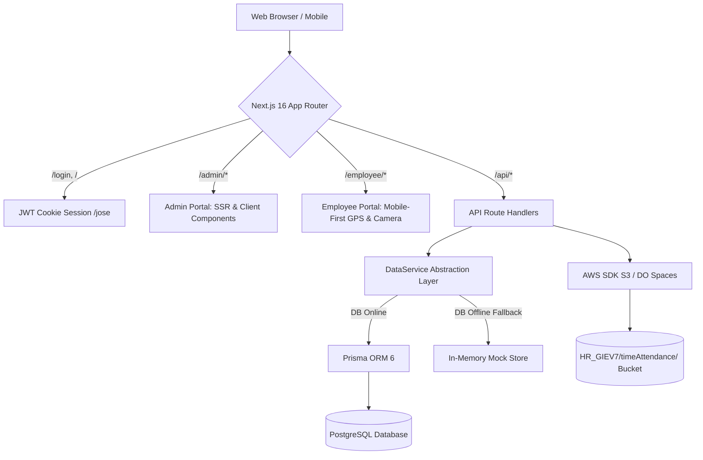
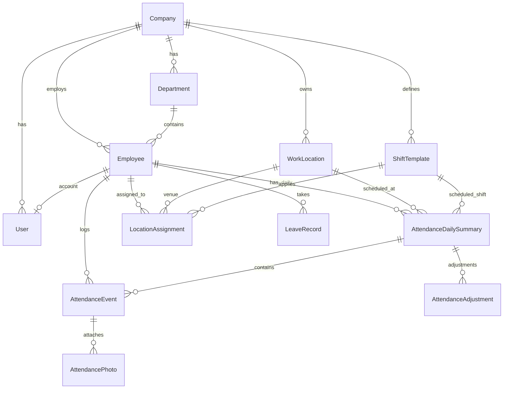
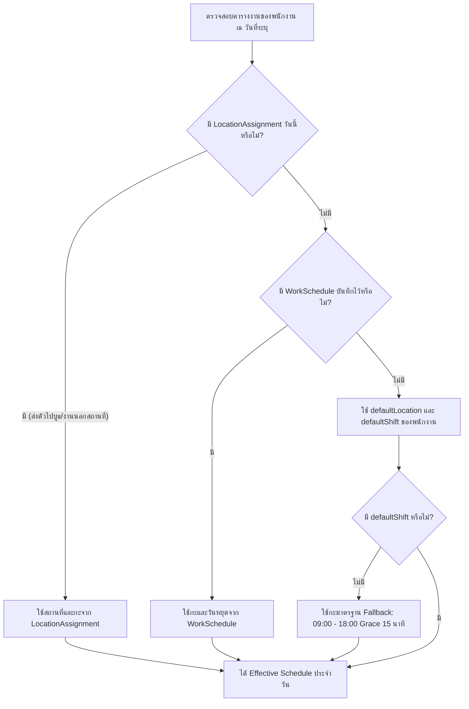

# คู่มือโครงสร้างระบบ ตรรกะการทำงาน และฟังก์ชันทั้งหมด (Skill & Code Architecture Guide)
> **ระบบบริหารงานบุคคลและบันทึกเวลาทำงาน (HR Management & Time Attendance System)**  
> รวบรวมสถาปัตยกรรม, โครงสร้างไฟล์, ฐานข้อมูล, ฟังก์ชัน Logic, กฎทางธุรกิจ, และ API ทั้งหมด เพื่อใช้เป็นเอกสารอ้างอิงหลักในการบำรุงรักษาและแก้ไขโค้ด

---

## สารบัญ (Table of Contents)
1. [ภาพรวมระบบและเทคโนโลยี (System Overview & Tech Stack)](#1-ภาพรวมระบบและเทคโนโลยี-system-overview--tech-stack)
2. [โครงสร้างไดเรกทอรีและไฟล์ (Project Directory Structure)](#2-โครงสร้างไดเรกทอรีและไฟล์-project-directory-structure)
3. [ฐานข้อมูลและโมเดลข้อมูล (Database Schema & Models)](#3-ฐานข้อมูลและโมเดลข้อมูล-database-schema--models)
4. [ระบบสิทธิ์และการเข้าสู่ระบบ (Authentication & Authorization)](#4-ระบบสิทธิ์และการเข้าสู่ระบบ-authentication--authorization)
5. [ตรรกะการคำนวณและประเมินเวลา (Attendance Evaluation Logic)](#5-ตรรกะการคำนวณและประเมินเวลา-attendance-evaluation-logic)
6. [ระบบพิกัด GPS และการตรวจจับรัศมี (Geolocation & Geofencing)](#6-ระบบพิกัด-gps-และการตรวจจับรัศมี-geolocation--geofencing)
7. [ระบบกล้องสดและการจัดเก็บไฟล์รูปภาพ (Camera & S3 Storage)](#7-ระบบกล้องสดและการจัดเก็บไฟล์รูปภาพ-camera--s3-storage)
8. [ระบบการจัดการกะและมอบหมายสถานที่พิเศษ (Schedule & Assignment Logic)](#8-ระบบการจัดการกะและมอบหมายสถานที่พิเศษ-schedule--assignment-logic)
9. [การแก้ไขเวลาและระบบบันทึกประวัติ (Attendance Correction & Audit Logs)](#9-การแก้ไขเวลาและระบบบันทึกประวัติ-attendance-correction--audit-logs)
10. [ระบบนำเข้าและส่งออก Excel (Excel Import & Export Engine)](#10-ระบบนำเข้าและส่งออก-excel-excel-import--export-engine)
11. [สถาปัตยกรรมบริการข้อมูล (DataService & Offline Fallback Architecture)](#11-สถาปัตยกรรมบริการข้อมูล-dataservice--offline-fallback-architecture)
12. [สรุปรายการ API ทั้งหมด (Complete API Reference)](#12-สรุปรายการ-api-ทั้งหมด-complete-api-reference)
13. [แนวทางการแก้ไขและการต่อขยายระบบ (Developer Best Practices)](#13-แนวทางการแก้ไขและการต่อขยายระบบ-developer-best-practices)

---

## 1. ภาพรวมระบบและเทคโนโลยี (System Overview & Tech Stack)

ระบบนี้ถูกออกแบบมาเพื่อรองรับองค์กรที่มีหลายบริษัทในเครือ (Multi-Company) เช่น กลุ่มบริษัท **Gold Integrate (GI)** และ **EV7** โดยแบ่งสถาปัตยกรรมการใช้งานออกเป็น 2 ส่วนหลัก (Dual-Portal):

1. **Admin Web Portal (`/admin/*`)**: 
   - สำหรับฝ่ายบุคคล (HR Admin) และผู้ดูแลระบบสูงสุด (Super Admin)
   - ใช้งานผ่านเบราว์เซอร์บน Desktop/Tablet
   - ความสามารถ: จัดการข้อมูลพนักงาน, จัดการสาขา/บูธ (Work Locations), กำหนดกะการทำงาน (Shift Templates), มอบหมายพนักงานไปประจำบูธนอกสถานที่ (Location Assignments), ตรวจสอบเวลาพร้อมภาพถ่ายและระยะ GPS, แก้ไขเวลาพร้อมระบุเหตุผล (Audit Trail), และนำเข้า-ส่งออกข้อมูล Excel

2. **Employee Mobile Portal (`/employee/*`)**:
   - ออกแบบในรูปแบบ **Mobile-First Responsive** เหมาะสำหรับการเปิดผ่านสมาร์ตโฟน
   - ความสามารถ: ดูข้อมูลกะงานและสถานที่ของตนเองประจำวัน, บันทึกเวลาเข้างาน (Check-In) และออกงาน (Check-Out) ด้วยกล้องสด (Live Camera) ร่วมกับการตรวจสอบพิกัด GPS ว่าอยู่ในรัศมีที่กำหนดหรือไม่, และดูประวัติการลงเวลาย้อนหลัง



### รายการเทคโนโลยีหลัก (Dependencies)
- **Framework**: [Next.js](https://nextjs.org/) 16.4.0 (App Router, React 19.3.0)
- **Database & ORM**: PostgreSQL ผ่าน [Prisma Client](https://www.prisma.io/) 6.4.1
- **Styling**: [Tailwind CSS](https://tailwindcss.com/) v4 (`@tailwindcss/turbopack`)
- **Authentication**: JWT ผ่าน `jose` v6 (Stateless Cookie), รหัสผ่านเข้ารหัสด้วย `bcryptjs` v3
- **Object Storage**: `@aws-sdk/client-s3` v3 เชื่อมต่อกับ AWS S3 หรือ DigitalOcean Spaces
- **Excel Handling**: `xlsx` v0.18.5 สำหรับอ่านและสร้างไฟล์ `.xlsx`
- **Charts**: `recharts` v3 สำหรับแดชบอร์ดสรุปสถิติ HR
- **Icons**: `lucide-react`

---

## 2. โครงสร้างไดเรกทอรีและไฟล์ (Project Directory Structure)

```
hr/
├── prisma/
│   ├── schema.prisma              # โมเดลฐานข้อมูลและความสัมพันธ์ทั้งหมด
│   ├── seed.ts                    # ข้อมูลตั้งต้น (บริษัทในเครือ GI/EV7, แผนก, พนักงาน, กะ, พิกัด)
│   └── migrations/                # ประวัติการทำ Database Migration
├── src/
│   ├── app/                       # โครงสร้างหน้าเว็บและ API (App Router)
│   │   ├── page.tsx               # หน้าแรก (Landing & Role-based Redirection)
│   │   ├── layout.tsx             # Root Layout และฟอนต์ระบบ
│   │   ├── globals.css            # สไตล์ส่วนกลางและการกำหนดตัวแปรสี Tailwind
│   │   ├── login/page.tsx         # หน้าเข้าสู่ระบบ (ทั้ง Admin และ Employee)
│   │   ├── admin/                 # โครงข่ายหน้าจอสำหรับฝ่ายบุคคล
│   │   │   ├── layout.tsx         # Admin Layout (ห่อหุ้ม Sidebar + Header)
│   │   │   ├── page.tsx           # หน้า Dashboard แสดง Stat Cards และกราฟ
│   │   │   ├── attendance/        # จัดการรายการลงเวลา, ดูรูป, กรองสถานะ, แก้ไขเวลา
│   │   │   ├── employees/         # ทะเบียนพนักงาน, ฟอร์มเพิ่ม/แก้ไข, นำเข้า Excel
│   │   │   ├── locations/         # จัดการสาขา/สำนักงาน/บูธ, กำหนดพิกัด Lat/Lng และรัศมี
│   │   │   ├── shifts/            # กำหนดกะการทำงาน (เวลาเริ่ม, สิ้นสุด, Grace period)
│   │   │   ├── assignments/       # มอบหมายพนักงานไปประจำบูธหรือไซต์งานชั่วคราว
│   │   │   ├── holidays/          # ปฏิทินวันหยุดประจำปี (นำเข้า/ส่งออก Excel)
│   │   │   └── reports/           # รายงานสรุปการเข้างาน และส่งออก Excel
│   │   ├── employee/              # โครงข่ายหน้าจอสำหรับพนักงาน (Mobile View)
│   │   │   ├── layout.tsx         # Mobile Container & Bottom Navigation Bar
│   │   │   ├── page.tsx           # หน้าหลักพนักงาน: ดูสถานะวันนี้, กดเข้า/ออกงาน
│   │   │   ├── schedule/          # ปฏิทินตารางงานและกะประจำเดือนของพนักงาน
│   │   │   ├── history/           # ประวัติการลงเวลาย้อนหลังของตนเอง
│   │   │   └── profile/           # ข้อมูลส่วนตัวพนักงานและการออกจากระบบ
│   │   └── api/                   # Backend REST API Handlers
│   │       ├── auth/              # /api/auth (login, logout, me)
│   │       ├── admin/             # /api/admin/* (จัดการข้อมูลหลังบ้าน)
│   │       └── employee/          # /api/employee/* (ลงเวลา, ข้อมูลวันนี้, ประวัติ)
│   ├── components/                # คอมโพเนนต์ React UI
│   │   ├── ui/                    # คอมโพเนนต์พื้นฐาน (Button, Input, Select, Modal, Card, Badge)
│   │   ├── admin/                 # คอมโพเนนต์สำหรับฝั่ง Admin (Sidebar, Modals, Charts)
│   │   └── employee/              # คอมโพเนนต์สำหรับฝั่งพนักงาน (Camera Modal, Nav, Cards)
│   └── lib/                       # Business Logic, Helper และ Services หลัก
│       ├── prisma.ts              # Prisma Client Singleton Instance
│       ├── auth.ts                # ระบบตรวจสอบสิทธิ์, JWT Cookie, Hashing
│       ├── attendance.ts          # ตรรกะคำนวณการสาย, กลับก่อน, สถานะเวลา (Timezone Asia/Bangkok)
│       ├── geo.ts                 # สูตร Haversine คำนวณระยะห่างพิกัด GPS และรัศมีเมตร
│       ├── s3.ts                  # อัปโหลดภาพถ่ายลง S3/Spaces จัดโครงสร้างโฟลเดอร์ตามเดือน
│       ├── camera.ts              # ควบคุม Lifecycle ของ WebRTC MediaStream กล้องโทรศัพท์
│       ├── excel.ts               # ตัวประมวลผลอ่านไฟล์และสร้างไฟล์ Excel Template/Report
│       ├── audit.ts               # ฟังก์ชันบันทึก Audit Trail ของระบบ
│       └── data-service.ts        # Data Access Layer แบบ DB-First พร้อม In-Memory Resilient Fallback
└── skill_code.md                  # เอกสารคู่มือโครงสร้างและตรรกะระบบ (ไฟล์นี้)
```

---

## 3. ฐานข้อมูลและโมเดลข้อมูล (Database Schema & Models)

ระบบใช้ฐานข้อมูลแบบเชิงสัมพันธ์ (Relational Database) รองรับ Multi-Tenancy ระดับบริษัท โดยมีโมเดลสำคัญดังนี้:

### สรุปความสัมพันธ์ (ER Relations)


### รายละเอียดโมเดลหลัก (Schema Definitions)

1. **Company (บริษัท)**
   - `id`, `code` (Unique เช่น "GI", "GI01", "GI06"), `name`, `taxId`, `address`, `active`
2. **Department (แผนก)**
   - `id`, `companyId`, `code`, `name`, `active` (Unique คู่กับ `[companyId, code]`)
3. **User (ผู้ใช้งานระบบ)**
   - `id`, `email` (Unique), `passwordHash`, `name`, `role` (`SUPER_ADMIN` | `HR_ADMIN` | `EMPLOYEE`), `companyId`, `employeeId` (Unique 1-to-1 กับ Employee), `active`
4. **Employee (ข้อมูลพนักงาน)**
   - `id`, `employeeId` (Unique รหัสพนักงาน เช่น "EMP-001"), `firstName`, `lastName`, `email`, `phone`, `position`
   - `companyId`, `departmentId`
   - `employmentStatus`: `ACTIVE` | `INACTIVE` | `RESIGNED` | `SUSPENDED`
   - `defaultShiftId`: กะงานประจำเริ่มต้น (Foreign Key -> `ShiftTemplate`)
   - `defaultLocationId`: สถานที่ทำงานประจำเริ่มต้น (Foreign Key -> `WorkLocation`)
5. **WorkLocation (สถานที่ทำงาน/สาขา/บูธ)**
   - `id`, `locationCode` (Unique), `locationName`, `companyId`
   - `locationType`: `OFFICE` (สำนักงาน/สาขา) | `BOOTH` (บูธกิจกรรม/จัดแสดง)
   - `latitude`, `longitude` (Float สำหรับคำนวณ GPS)
   - `allowedRadiusMeters`: รัศมีที่อนุญาตให้ลงเวลาได้ (ค่าเริ่มต้น 100 เมตร)
6. **ShiftTemplate (กะการทำงาน)**
   - `id`, `shiftCode` (Unique เช่น "NORMAL", "MORNING"), `shiftName`
   - `startTime`: รูปแบบ "HH:mm" เช่น "09:00"
   - `endTime`: รูปแบบ "HH:mm" เช่น "18:00"
   - `gracePeriodMinutes`: เวลาผ่อนผันการมาสาย เช่น 15 นาที
7. **LocationAssignment (การมอบหมายสถานที่ปฏิบัติงานพิเศษ)**
   - `id`, `employeeId`, `date` (Date เฉพาะวันนั้น), `workLocationId`, `shiftTemplateId`, `assignmentType` (`BOOTH` | `TEMPORARY` | `PROJECT`), `notes`
   - **สำคัญ**: ใช้ Override กะและสถานที่ของพนักงานในวันที่มีการส่งตัวไปทำงานนอกสถานที่หรือประจำบูธ
8. **AttendanceDailySummary (สรุปการลงเวลาประจำวันของพนักงาน)**
   - `id`, `employeeId`, `companyId`, `date` (Unique คู่กับ `[employeeId, date]`)
   - `scheduledShiftId`, `scheduledLocationId`, `effectiveStartTime`, `effectiveEndTime`
   - `checkInTime`, `checkOutTime`
   - `checkInPhotoUrl`, `checkOutPhotoUrl` (ลิงก์รูปภาพใน S3)
   - `checkInDistanceMeters`, `checkOutDistanceMeters` (ระยะห่างจากพิกัดเป้าหมาย)
   - `attendanceStatus`: `PRESENT` | `LATE` | `ABSENT` | `EARLY_LEAVE` | `MISSING_CHECKOUT` | `DAY_OFF` | `ON_LEAVE`
   - `isLate`, `lateMinutes`, `isEarlyLeave`, `earlyLeaveMinutes`, `totalWorkMinutes`
   - `isCorrected`, `correctionReason`, `correctedById`, `correctedAt` (สถานะการแก้ไขโดย HR)
9. **AttendanceEvent (บันทึกจังหวะการกดปุ่มเข้า-ออกงาน)**
   - `id`, `employeeId`, `eventType` (`CHECK_IN` | `CHECK_OUT`), `eventTime`, `latitude`, `longitude`, `distanceMeters`, `isWithinRadius`, `photoUrl`, `deviceInfo`
10. **AttendanceAdjustment (ประวัติการแก้ไขเวลาโดย HR - Audit Trail)**
    - `id`, `dailySummaryId`, `employeeId`, `adjustedById`, `previousCheckIn`, `newCheckIn`, `previousCheckOut`, `newCheckOut`, `previousStatus`, `newStatus`, `reason`
11. **LeaveRecord & Holiday**
    - บันทึกการลา (`LeaveRecord`: `ANNUAL`, `SICK`, `PERSONAL`) และวันหยุดนักขัตฤกษ์ (`Holiday`)
12. **AuditLog**
    - บันทึกทุกความเคลื่อนไหวสำคัญของระบบ (`action`, `entity`, `entityId`, `details`, `ipAddress`)

---

## 4. ระบบสิทธิ์และการเข้าสู่ระบบ (Authentication & Authorization)

ระบบใช้ **JWT Stateless Cookie Authentication** ผ่านโมดูล [`src/lib/auth.ts`](file:///Users/kanittamac/web/hr/src/lib/auth.ts):

### บทบาทผู้ใช้งาน (Roles & Permissions)
| บทบาท (Role) | สิทธิ์การเข้าถึง (Access Rights) | หน้า Landing หลัง Login |
| :--- | :--- | :--- |
| **`SUPER_ADMIN`** | เข้าถึงได้ทุกบริษัทในเครือ, สลับดูข้อมูลทุกสาขา, แก้ไขกะ/สถานที่/พนักงาน/เวลาได้ทั้งหมด | `/admin` |
| **`HR_ADMIN`** | เข้าถึงเฉพาะข้อมูลบริษัทที่ตนเองสังกัด (`user.companyId`), จัดการพนักงานและเวลาในบริษัทตนเอง | `/admin` |
| **`EMPLOYEE`** | ใช้งานได้เฉพาะหน้าพนักงาน, ดูตารางงานตนเอง, บันทึกเวลาเข้า-ออกผ่านมือถือ | `/employee` |

### ขั้นตอนการ Login (`POST /api/auth/login`)
1. รับ `email` และ `password`
2. ค้นหา User ผ่าน `DataService.findUserByEmail()`
3. ตรวจสอบสถานะ `active === true`
4. เปรียบเทียบรหัสผ่านด้วย `bcrypt.compare(password, user.passwordHash)`
5. สร้าง JWT Token อายุ 7 วัน (`HS256`) บรรจุ:
   ```json
   {
     "id": "user-uuid",
     "email": "user@goldintegrate.co.th",
     "name": "สมชาย ใจดี",
     "role": "EMPLOYEE",
     "companyId": "comp-uuid",
     "employeeId": "emp-uuid",
     "empCode": "EMP-001"
   }
   ```
6. เซ็ต Cookie ชื่อ `hr_session` เป็นแบบ `httpOnly`, `sameSite: "lax"`, และ `secure: true` เมื่ออยู่บน Production
7. ส่งคืน `redirectUrl`: `/employee` สำหรับพนักงาน หรือ `/admin` สำหรับผู้ดูแล

---

## 5. ตรรกะการคำนวณและประเมินเวลา (Attendance Evaluation Logic)

ตรรกะทั้งหมดรวมศูนย์อยู่ที่ [`src/lib/attendance.ts`](file:///Users/kanittamac/web/hr/src/lib/attendance.ts) และ `DataService`:

### ข้อกำหนดเรื่องเขตเวลา (Timezone Handling)
- **Timezone มาตรฐาน**: `Asia/Bangkok` (UTC+7) เสมอ
- ห้ามดึงเวลาเครื่องเซิร์ฟเวอร์ตรงๆ โดยไม่ระบุ Timezone
- วันที่เริ่มต้นของวัน (Midnight Date) คำนวณเป็น `Date.UTC(year, month - 1, day, 0, 0, 0)` จากสตริง `YYYY-MM-DD` ของกรุงเทพฯ
- เวลาของกะ (เช่น "09:00") จะถูกแปลงเป็นเวลาจริงในวันนั้นผ่านสูตร:
  $$\text{UTC Hour} = \text{Target Hour} - 7$$

### กฎการคำนวณการเข้างาน (Check-In Logic)
1. ดึงเวลากะเริ่มงาน (`shiftStartTime`) และเวลาผ่อนผัน (`gracePeriodMinutes` ค่าเริ่มต้น 15 นาที)
2. กำหนดจุดตัดเวลาสาย: 
   $$\text{Grace Cutoff} = \text{Shift Start Time} + \text{gracePeriodMinutes}$$
3. หาก $\text{CheckInTime} > \text{Grace Cutoff}$:
   - `isLate = true`
   - คำนวณนาทีที่สาย:
     $$\text{lateMinutes} = \lfloor \frac{\text{CheckInTime} - \text{Shift Start Time}}{60 \times 1000} \rfloor$$
   - กำหนดสถานะเป็น `AttendanceStatus.LATE`
4. หากไม่เกิน Grace Cutoff:
   - `isLate = false`, `lateMinutes = 0`
   - กำหนดสถานะเป็น `AttendanceStatus.PRESENT`

### กฎการคำนวณการออกงาน (Check-Out Logic)
1. เมื่อพนักงานกด Check-Out บันทึกเวลา `checkOutTime`
2. คำนวณเวลารวมที่ปฏิบัติงาน:
   $$\text{totalWorkMinutes} = \lfloor \frac{\text{CheckOutTime} - \text{CheckInTime}}{60 \times 1000} \rfloor$$
3. ตรวจสอบการกลับก่อนเวลา (Early Leave):
   - หาก $\text{CheckOutTime} < \text{Shift End Time}$:
     - `isEarlyLeave = true`
     - คำนวณนาทีที่ออกก่อน:
       $$\text{earlyLeaveMinutes} = \lfloor \frac{\text{Shift End Time} - \text{CheckOutTime}}{60 \times 1000} \rfloor$$
     - ปรับสถานะเป็น `AttendanceStatus.EARLY_LEAVE` (ถ้าไม่ได้มาสายก่อนหน้า)
4. กรณี **ลืมลงเวลาออก (Missing Checkout)**:
   - หากพนักงาน Check-In ไว้ แต่เวลาปัจจุบันเลยเวลาเลิกงานไปเกิน 3 ชั่วโมง ($\text{Now} > \text{Shift End Time} + 3\text{h}$) โดยยังไม่มีการกด Check-Out
   - ระบบจะประเมินสถานะอัตโนมัติเป็น `AttendanceStatus.MISSING_CHECKOUT`

---

## 6. ระบบพิกัด GPS และการตรวจจับรัศมี (Geolocation & Geofencing)

ไฟล์ที่เกี่ยวข้อง: [`src/lib/geo.ts`](file:///Users/kanittamac/web/hr/src/lib/geo.ts)

### สูตรคำนวณระยะห่าง (Haversine Formula)
ระบบคำนวณระยะห่างทางภูมิศาสตร์ระหว่างพิกัด GPS จริงของมือถือพนักงาน กับพิกัดสถานที่ปฏิบัติงานเป้าหมาย ด้วยสูตร Haversine บนสมมติฐานรัศมีโลก $R = 6,371,000$ เมตร:

$$a = \sin^2\left(\frac{\Delta\phi}{2}\right) + \cos(\phi_1)\cos(\phi_2)\sin^2\left(\frac{\Delta\lambda}{2}\right)$$
$$c = 2 \cdot \text{atan2}\left(\sqrt{a}, \sqrt{1 - a}\right)$$
$$\text{distanceMeters} = R \cdot c$$

```typescript
// ตัวอย่างการใช้งานใน src/lib/geo.ts
const { isWithin, distanceMeters } = isWithinRadius(
  userLat, userLon,
  targetLat, targetLon,
  allowedRadiusMeters // เช่น 100 เมตร
);
```

### การบังคับใช้กฎ (Geofencing Enforcement)
- ทั้งการ Check-In และ Check-Out จะถูกส่งพิกัดมาตรวจสอบที่ Server เสมอ
- หาก $\text{distanceMeters} > \text{allowedRadiusMeters}$:
  - ระบบจะปฏิเสธการลงเวลาทันที (HTTP Status 400)
  - ตอบกลับข้อความแจ้งเตือน: *"คุณอยู่นอกพื้นที่ที่กำหนด (ระยะห่าง X เมตร, อนุญาตไม่เกิน Y เมตร)"*

---

## 7. ระบบกล้องสดและการจัดเก็บไฟล์รูปภาพ (Camera & S3 Storage)

ไฟล์ที่เกี่ยวข้อง:
- [`src/components/employee/CameraCaptureModal.tsx`](file:///Users/kanittamac/web/hr/src/components/employee/CameraCaptureModal.tsx)
- [`src/lib/camera.ts`](file:///Users/kanittamac/web/hr/src/lib/camera.ts)
- [`src/lib/s3.ts`](file:///Users/kanittamac/web/hr/src/lib/s3.ts)

### นโยบายภาพถ่ายกล้องสด (Live Camera Only)
1. **ป้องกันการโกง**: ไม่อนุญาตให้กดอัปโหลดไฟล์จากคลังภาพหรือ Gallery
2. **WebRTC Stream**: บังคับเปิดกล้องหน้า (`facingMode: "user"`) ผ่าน `navigator.mediaDevices.getUserMedia`
3. **Capture via Canvas**: เมื่อพนักงานกดยืนยัน จะทำ Snapshot เฟรมภาพจาก `<video>` ลงบน `<canvas>` เพื่อแปลงเป็น Base64 JPEG (`data:image/jpeg;base64,...`)
4. **Hardware Lifecycle Safety**: 
   - ฟังก์ชัน `stopMediaStream()` และ `stopAllActiveMediaStreams()` ใน `src/lib/camera.ts` จะตัดสัญญาณฮาร์ดแวร์กล้อง (`track.stop()`) ทันทีที่ปิด Modal หรือลงเวลาสำเร็จ ป้องกันปัญหากล้องค้างหรือไฟกล้องเปิดค้างบนมือถือ

### โครงสร้างการจัดเก็บไฟล์ใน S3 / DigitalOcean Spaces
- **Bucket**: อ้างอิงจาก `AWS_BUCKET_NAME` ใน `.env` (เช่น `space-workflow-dev`)
- **Key Pattern**:
  ```
  HR_GIEV7/timeAttendance/{YYYYMM}/{employeeCode}_{YYYYMMDD_HHmmss}.jpg
  ```
  *ตัวอย่าง*: `HR_GIEV7/timeAttendance/202610/EMP001_20261020_084530.jpg`
- **การประมวลผล**: แปลง Base64 สู่ Buffer -> ส่งคำสั่ง `PutObjectCommand` พร้อม `ContentType: "image/jpeg"` และ `ACL: "public-read"` -> คืนค่า Public URL ที่เข้าถึงได้ทันที

---

## 8. ระบบการจัดการกะและมอบหมายสถานที่พิเศษ (Schedule & Assignment Logic)

ตรรกะในฟังก์ชัน `DataService.getEffectiveSchedule(employeeId, date)`:

### ลำดับความสำคัญในการกำหนดสถานที่และกะงาน (Priority Resolution Order)


- **บูธ (Booth Assignment)**: เมื่อพนักงานถูกส่งไปประจำบูธพิเศษ ระบบจะตรวจจับแฟล็ก `isBooth = true` และแสดง Banner แจ้งเตือนสีส้มบนแอปมือถือพนักงาน พร้อมเปลี่ยนเป้าหมายพิกัด GPS ไปยังบูธดังกล่าวทันที

---

## 9. การแก้ไขเวลาและระบบบันทึกประวัติ (Attendance Correction & Audit Logs)

ไฟล์ที่เกี่ยวข้อง:
- [`src/app/api/admin/attendance/correct/route.ts`](file:///Users/kanittamac/web/hr/src/app/api/admin/attendance/correct/route.ts)
- [`src/components/admin/AttendanceCorrectionModal.tsx`](file:///Users/kanittamac/web/hr/src/components/admin/AttendanceCorrectionModal.tsx)

### กฎการแก้ไขเวลา (Correction Rules)
1. **ผู้มีสิทธิ์**: เฉพาะ `SUPER_ADMIN` หรือ `HR_ADMIN` ที่สังกัดบริษัทนั้นเท่านั้น
2. **ข้อบังคับ**: ต้องระบุ **"เหตุผลในการแก้ไข (Reason)"** เสมอ หากไม่ระบุจะไม่ยอมให้บันทึก
3. **การบันทึก Audit Trail 2 ชั้น**:
   - ชั้นที่ 1: บันทึกประวัติลงในตาราง `AttendanceAdjustment` (เก็บค่าเดิม vs ค่าใหม่, ผู้แก้ไข, เหตุผล)
   - ชั้นที่ 2: บันทึกตาราง `AuditLog` สำหรับตรวจสอบ System Activity ในระดับองค์กร
4. **การคำนวณใหม่**: ระบบจะคำนวณสถานะเวลาใหม่ (Status, Late Minutes, Work Hours) ให้สอดคล้องกับเวลาใหม่ที่ HR ระบุ พร้อมตั้งค่า `isCorrected = true`

---

## 10. ระบบนำเข้าและส่งออก Excel (Excel Import & Export Engine)

ไฟล์ที่เกี่ยวข้อง: [`src/lib/excel.ts`](file:///Users/kanittamac/web/hr/src/lib/excel.ts)

### 1. นำเข้าพนักงาน (Employee Excel Import)
- รองรับหัวตารางทั้งภาษาไทยและอังกฤษ:
  - `employeeId` / `รหัสพนักงาน`
  - `firstName` / `ชื่อ`
  - `lastName` / `นามสกุล`
  - `companyCode` / `รหัสบริษัท` (เช่น GI, GI01, GI06)
  - `departmentCode` / `รหัสแผนก` (เช่น OPS, HR, IT)
  - `position` / `ตำแหน่ง`
  - `startDate` / `วันเริ่มงาน` (รูปแบบ YYYY-MM-DD)
  - `defaultShiftCode`, `defaultLocationCode`
- มีระบบตรวจสอบความถูกต้อง (Validation): ตรวจรหัสบริษัท/แผนกว่ามีอยู่จริงหรือไม่, ตรวจรูปแบบวันที่, ตรวจจับรหัสพนักงานซ้ำ

### 2. ดาวน์โหลด Template & ส่งออกรายงาน (Reports Export)
- `generateEmployeeTemplate()`: สกัดแม่แบบ Excel พร้อมคำอธิบายและตัวอย่างข้อมูล
- `generateExcelReport(records, options)`: ส่งออกรายการลงเวลาพร้อมฟิลด์ละเอียด:
  - รหัสพนักงาน, ชื่อ-นามสกุล, บริษัท, แผนก, วันที่, กะงาน
  - เวลาเข้า, เวลาออก, สถานะ (ปกติ/สาย/ขาด/กลับก่อน), จำนวนนาทีที่สาย, ชั่วโมงทำงานรวม
  - พิกัด GPS, ระยะห่างเป็นเมตร, ลิงก์คลิกดูภาพถ่าย S3

---

## 11. สถาปัตยกรรมบริการข้อมูล (DataService & Offline Fallback Architecture)

ไฟล์ที่เกี่ยวข้อง: [`src/lib/data-service.ts`](file:///Users/kanittamac/web/hr/src/lib/data-service.ts)

เพื่อให้ระบบมีความทนทานสูงสุด (Resilience) และสามารถรันบนเครื่อง Local Dev ได้แม้ยังไม่ได้ต่อฐานข้อมูล PostgreSQL ตัว `DataService` จึงถูกสร้างขึ้นเป็นตัวกลางหุ้ม (Wrapper Layer):

```mermaid
flowchart LR
    Caller[API / UI Component] --> DataService[DataService API]
    DataService --> Check{isDatabaseConnected()}
    Check -- True (5s Cache) --> PrismaClient[Prisma Client -> Real Database]
    Check -- False --> MemoryStore[MemoryStore In-Memory Data]
```

- **Health Check Caching**: มีตัวแปรแคชผลการต่อฐานข้อมูลเป็นเวลา 5 วินาที เพื่อไม่ให้ยิง `SELECT 1` ซ้ำซ้อนในทุก Request
- **In-Memory Store**: มีโครงสร้างข้อมูลจำลองบริษัท GI01-GI10, พนักงานตัวอย่าง, กะงาน, และสถานะการลงเวลา พร้อมใช้งานตลอดเวลา

---

## 12. สรุปรายการ API ทั้งหมด (Complete API Reference)

### Authentication APIs
| Method | Endpoint | สิทธิ์ | หน้าที่การทำงาน |
| :--- | :--- | :--- | :--- |
| `POST` | `/api/auth/login` | Public | ตรวจสอบอีเมล/รหัสผ่าน และออก Session Cookie |
| `POST` | `/api/auth/logout` | Session | ลบ Cookie `hr_session` |
| `GET` | `/api/auth/me` | Session | ดึงข้อมูลโปรไฟล์และบทบาทของผู้ใช้ปัจจุบัน |

### Employee APIs (Mobile Portal)
| Method | Endpoint | สิทธิ์ | หน้าที่การทำงาน |
| :--- | :--- | :--- | :--- |
| `GET` | `/api/employee/today` | Employee | ดึงข้อมูลกะงาน, สถานะลงเวลา, และสถานที่เป้าหมายวันนี้ |
| `POST` | `/api/employee/check-in` | Employee | บันทึกเวลาเข้างาน (ตรวจรัศมี GPS + อัปโหลดรูป S3) |
| `POST` | `/api/employee/check-out` | Employee | บันทึกเวลาออกงาน (ตรวจรัศมี GPS + คำนวณชั่วโมงงาน) |
| `GET` | `/api/employee/schedule` | Employee | ดึงตารางงานและกะของพนักงานตามช่วงเดือน |
| `GET` | `/api/employee/history` | Employee | ดูประวัติการลงเวลาย้อนหลังของตนเอง |
| `GET` | `/api/employee/profile` | Employee | ดูข้อมูลส่วนตัวและแผนกของพนักงาน |

### Admin APIs (Management Portal)
| Method | Endpoint | สิทธิ์ | หน้าที่การทำงาน |
| :--- | :--- | :--- | :--- |
| `GET` | `/api/admin/dashboard` | Admin | ดึงตัวเลขสรุปสถิติประจำวัน (มา, สาย, ขาด, กราฟรายชั่วโมง) |
| `GET` | `/api/admin/attendance` | Admin | ดึงรายการลงเวลาพนักงาน กรองตามวันที่/บริษัท/แผนก/สถานะ |
| `POST` | `/api/admin/attendance/correct` | Admin | แก้ไขเวลาลงงานหรือสถานะ พร้อมบันทึกเหตุผล Audit Trail |
| `GET/POST` | `/api/admin/employees` | Admin | ค้นหา/ดึงรายชื่อพนักงาน หรือสร้างพนักงานใหม่ |
| `PUT/DELETE`| `/api/admin/employees/[id]`| Admin | แก้ไขข้อมูลพนักงาน หรือระงับสถานะ |
| `POST` | `/api/admin/employees/import` | Admin | อัปโหลดไฟล์ Excel เพื่อนำเข้าพนักงานแบบกลุ่ม (Batch) |
| `GET` | `/api/admin/employees/export-template` | Admin | ดาวน์โหลดแบบฟอร์มเปล่า Excel สำหรับกรอกข้อมูลพนักงาน |
| `GET/POST` | `/api/admin/locations` | Admin | ดึงหรือบันทึกสถานที่ทำงาน/บูธ กำหนด Lat, Lng และ รัศมี |
| `GET/POST` | `/api/admin/shifts` | Admin | ดึงหรือสร้างกะการทำงาน (เวลาเข้า-ออก, Grace period) |
| `GET/POST` | `/api/admin/assignments` | Admin | ดึงหรือสร้างการมอบหมายพนักงานไปประจำบูธนอกสถานที่ |
| `DELETE` | `/api/admin/assignments/[id]` | Admin | ลบรายการมอบหมายพนักงาน |
| `GET` | `/api/admin/reports/export` | Admin | ส่งออกรายงานการเข้างานเป็นไฟล์ Excel (`.xlsx`) |
| `GET/POST` | `/api/admin/holidays` | Admin | ดึงหรือบันทึกวันหยุดประจำปี |
| `GET` | `/api/admin/companies` | Admin | รายชื่อบริษัททั้งหมดในเครือ |
| `GET` | `/api/admin/departments` | Admin | รายชื่อแผนกทั้งหมดในบริษัท |

---

## 13. แนวทางการแก้ไขและการต่อขยายระบบ (Developer Best Practices)

เมื่อต้องการปรับปรุงโค้ดหรือพัฒนาฟีเจอร์เพิ่มเติม ควรปฏิบัติตามแนวทางดังนี้:

1. **การจัดการวันที่และเวลา**:
   - นำเข้าฟังก์ชันจาก [`src/lib/attendance.ts`](file:///Users/kanittamac/web/hr/src/lib/attendance.ts) เสมอ (เช่น `getBangkokToday()`, `formatBangkokDate()`, `formatBangkokTime()`)
   - หลีกเลี่ยงการใช้ `new Date().toISOString()` ในการเปรียบเทียบวันโดยตรง เพราะจะทำให้วันที่คลาดเคลื่อนไป 1 วันตามเวลา UTC

2. **การอัปโหลดรูปภาพลง S3**:
   - ใช้ฟังก์ชัน `uploadAttendanceImage()` ใน [`src/lib/s3.ts`](file:///Users/kanittamac/web/hr/src/lib/s3.ts) เสมอ เพื่อให้การตั้งชื่อไฟล์และลำดับโฟลเดอร์เป็นมาตรฐานเดียวกันทั่วทั้งระบบ: `HR_GIEV7/timeAttendance/{YYYYMM}/{EMP}_{DATETIME}.jpg`

3. **การจัดการฮาร์ดแวร์กล้อง**:
   - หากมีการปรับปรุงหน้ากล้อง ให้คงการเรียก `stopMediaStream()` หรือ `stopAllActiveMediaStreams()` ใน Lifecycle `useEffect` unmount เสมอ เพื่อไม่ให้เกิดปัญหากล้องค้างบนสมาร์ตโฟนของพนักงาน

4. **การเพิ่มสิทธิ์หรือฟิลด์ข้อมูล**:
   - เมื่อมีการเพิ่ม Field ใน `prisma/schema.prisma`:
     1. รัน `npx prisma migrate dev --name <migration_name>` หรือ `npx prisma db push`
     2. อัปเดต Interface ใน `src/lib/data-service.ts` (ทั้งฝั่ง Prisma model และ `memoryStore` จำลอง) เพื่อให้ระบบยังคงทำงานได้ต่อเนื่องทั้งสองโหมด

5. **สถาปัตยกรรมรองรับอนาคต (Planned Extensions)**:
   - **ระบบขออนุมัติการลา (Leave Request Workflow)**: มีตาราง `LeaveRecord` รองรับแล้ว สามารถต่อยอดหน้า UI ส่งคำขอและปุ่มกดอนุมัติสำหรับผู้จัดการ
   - **การแจ้งเตือนผ่าน LINE Notify / LINE OA**: สามารถเพิ่ม Webhook Trigger ในฟังก์ชัน `recordCheckIn` และ `recordCheckOut` เพื่อส่งข้อความแจ้งหัวหน้างานเมื่อพนักงานลงเวลาสำเร็จ
